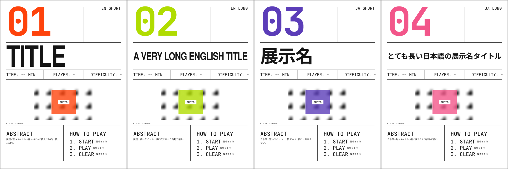

# festival-panels

文化祭の展示紹介パネル(3:4 縦, 840×1120pt)を Typst で作るためのテンプレートと素材。
スイス・タイポグラフィ風のレイアウトで、`panel()` に番号・タイトル・スペック・概要・遊び方を渡すと 1 枚できる。



## ビルド

```sh
./build.sh                  # 全展示をまとめてビルド(ないものは飛ばす)
./build.sh linetrace/linetrace.typ   # 1 つだけ(リポジトリ直下から)
typst compile --root . linetrace/linetrace.typ   # 直接叩くときも --root . が必要
```

展示ごとのフォルダは、ルートの `template.typ` を `#import "../template.typ"` で共有する。
そのためコンパイル時のルート(`--root`)は、`template.typ` を含むフォルダか、その上位にする
(エディタのルートが `kosen/` など上位でも動く。ファイル自身のフォルダだけがルートだと
`would escape the project root` になる)。
`logo:` の文字列パスは `template.typ` 側で読まれるので、`template.typ` からの相対パス
(例 `"raspberyth/logos/xxx.svg"`)で書く。`image(...)` で渡す写真(`visual:` / `howto()` の `image:`)は
書いたファイルからの相対パスでよい。

必要なフォント: TeX Gyre Heros / JetBrains Mono / Noto Sans CJK JP
(Linux なら `~/.local/share/fonts` に入れて `fc-cache -f`)。

## 使い方

```typst
#import "template.typ": *
#show: setup

#panel(
  number: "01", category: "CATEGORY", title: "TITLE",
  specs: ("TIME: 03 MIN", "PLAYER: 1", "DIFFICULTY: II"),
  accent: rgb("#FE430C"),
  abstract-text: [概要],
  how-to: ("START — 説明", "PLAY — 説明", "CLEAR — 説明"),
)
```

- `logo: "logos/xxx.svg"` — タイトルをロゴ(SVG)にする。SVG 内の `LOGOCOLOR` が `accent` に置き換わる。
- `title-stretch` / `title-size` — タイトルの縦倍率と文字サイズの上限。既定は `auto`(英字は 130% / 150pt、日本語は 100% / 120pt)。
- `visual: image(...)` — 写真。未指定ならドットのプレースホルダ。
- 背景色・フォントは冒頭の `ground` / `f-sans` / `f-mono` / `f-num` / `f-jp`。

## 写真の加工

```sh
./make-visual.sh 写真.jpg 出力.png "#B0DC01"   # 白黒ハーフトーン + アクセント色の正方形(乗算)
```

ImageMagick が必要。出力を `visual: image("出力.png")` に渡す。

## フォルダ構成

| フォルダ | 内容 |
|---|---|
| `linetrace/` | ライントレースカー(パネル + 詳細ページの 2 ページ) |
| `susume/` | Typstのすゝめ(写真枠なしの文字だけのパネル) |
| `map/` | KCCT-navi(校内マップ ナビ)。内容は [KCCT-navi](https://github.com/i0roche/KCCT-navi) の README、地図はそのリポジトリの `map.svg` |

他の人が作った展示(パケット配送ゲーム・RaspBeryth・VR・髙田研究室)は、ロゴや素材が本人のものなので公開していない。
手元には同じ形式のフォルダがあり、`all-local.typ` で全展示を 1 つの PDF にまとめている(`.gitignore` で除外)。

| ファイル | 内容 |
|---|---|
| `template.typ` | `panel()` 本体と共通設定(`#show: setup`) |
| `panel.typ` | 使用例(文字タイトルの 4 枚。ロゴなしで組める) |
| `all.typ` | 公開している展示(linetrace / susume / map)をまとめた PDF の元 |
| `build.sh` | 全展示のビルド(ファイルがない展示は飛ばす) |
| `make-visual.sh` | 写真のハーフトーン加工 |

## ロゴについて

展示物のロゴは他人の著作物なので、このリポジトリには含めていない。
手元でロゴ入りにするときは `logos/` に SVG を置き、`logo: "logos/xxx.svg"` を指定する
(`raspberyth/` のロゴ入りファイルと `logos/` は `.gitignore` で除外)。SVG の線色にしたい箇所を `LOGOCOLOR` にしておくと `accent` で塗られる。
